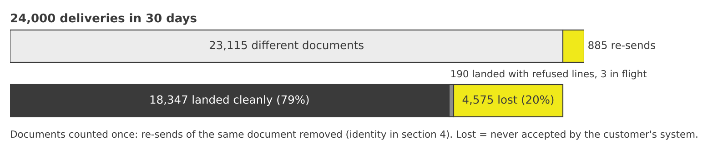
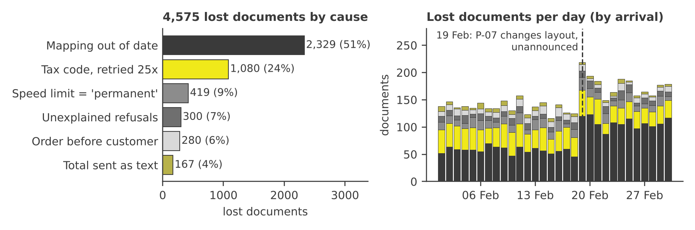
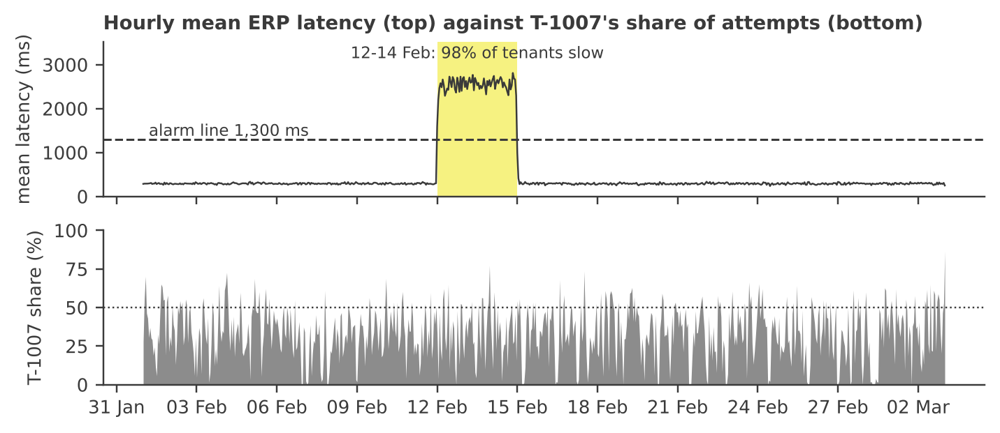
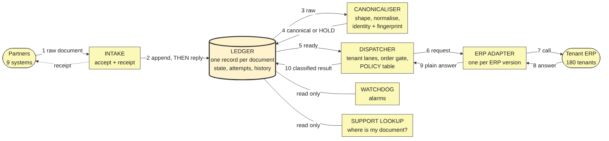
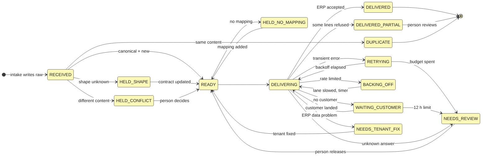
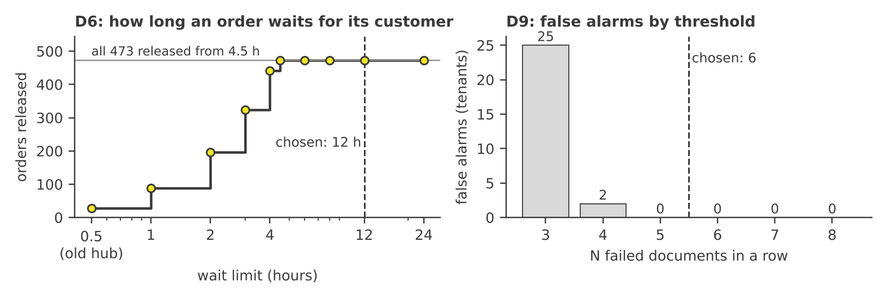
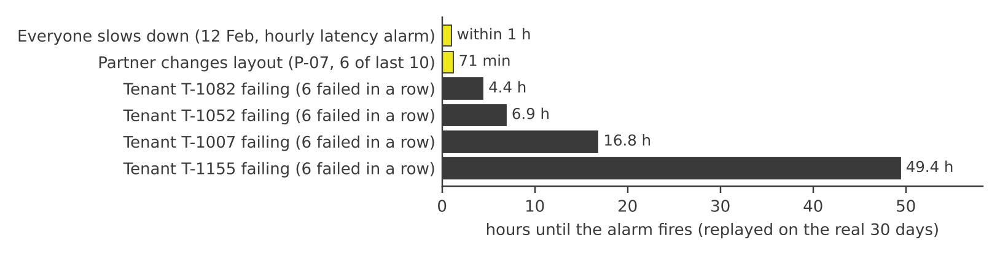

# The Integration Hub: what is wrong, and what replaces it

Data window 1 Feb to 2 Mar 2026 (30 days); "today" is 3 Mar. Every figure comes from code in `analysis/` or `hub_slice.py`, with outputs saved beside it. *Document* = one business document (an order, invoice, customer record or shipment). *Delivery* = one arrival of it. *Attempt* = one try to put it into a customer's system. *ERP* = that customer's business software; *tenant* = one customer's installation (180 of them).

---

## 1. Executive summary

<table class="stats"><tr><td><b>4,575</b>documents lost<br>20% of 23,115</td><td><b>885</b>posted twice<br>incl. 202 invoices</td><td><b>1,942</b>lost with no record<br>42% of the lost</td><td><b>54%</b>of all attempts<br>repeat tries that never worked</td></tr></table>



**What is going wrong.** In 30 days partners sent 24,000 documents; counting a re-send once, 23,115 different ones.

- **About 150 a day never reached the customer's business system.** 177 of our 180 customers lost at least one.
- **About 30 a day arrived twice.** This is what Finance found.
- **The hub's own list of failures missed 42% of the losses.** It caught only 57.5%.
- **190 orders were reported as delivered although part was refused** (266 of 520 lines).

**Why.**

1. **Out-of-date set-up: half of all losses (2,329).** Three customers got *nothing* all month (1,266 documents): the hub cannot talk to their newer system version. On 19 February one partner changed its document layout and the hub did not notice: 852 of its 1,023 documents (83%) were lost from then, against 17% before.
2. **Retrying what can never work (1,080).** Mostly one customer's tax setting. Each document was tried 25 times; none got through.
3. **No memory.** Partners re-sent 898 documents, 894 after the first copy had landed. The hub posted 885 a second time.
4. **Giving up at the wrong moment.** Orders arriving before their customer record were dropped (280). Customers who hit a speed limit were never retried (419).

One report did not hold up: no customer slowed the others. The "six-hour backlog" is real but is one customer's own retries (T-1007, up to 10.0 h). Two unreported problems showed up: **a 72-hour slowdown across almost every customer, 12 to 14 February**, and **partner P-09 sending nothing for 9 days from 22 February** (about 827 documents missing, an estimate).

**What I propose.** One rule: *a document is written down before anyone is told it arrived, and from then on it always has a named state and a named owner.* So: (1) a document is identified by customer + type + number, so re-sends are never posted twice; (2) every failure is sorted into retry, wait, needs-us or needs-the-customer, and none is thrown away; (3) one customer's trouble cannot use up others' capacity; (4) support types an order number and sees where it is and who must act; (5) alarms for failures that went unnoticed. Replaying the real 30 days: all 885 double postings stop and all 24,000 arrivals end in a named state, so "how many documents have we lost?" becomes one count you read any morning. 3,195 of the losses (70%) come from our own settings, so we can fix them alone.

**Cost of doing nothing.** Every day about 150 documents fail (about 65 invisibly) and about 30 are posted twice. Three customers stay cut off and the next slowdown goes unnoticed. (Definitions and exclusions for every figure: section 2.)

---

## 2. Diagnosis

### 2.1 How I earned the numbers

| Check | Finding → action |
|---|---|
| Duplicate rows | 240 exact duplicates in the attempts file (log shipper re-run by hand) → removed: 57,072 → 56,832 attempts |
| Orphans | None: every attempt and dead-letter row matches an arrival, and every arrival has an attempt |
| Timestamps | All UTC, but `sent_at` is later than `received_at` on 885 deliveries (partner clocks up to 10 min fast) → SLA judged from `received_at`: 45 breaches, against 766 from `sent_at` |
| In flight | Longest retry chain is 72 min → 3 documents still mid-retry at the end of the data are excluded from "lost" |
| Success | Taken at face value, except `207 partial_content` |
| **Hub labels** | **Wrong in both directions** (below) |

| Hub label | What happened |
|---|---|
| `invalid_tax_code`: retryable | 27,075 attempts, 1,083 documents, **0 recovered** |
| `unsupported_version`: retryable | 5,064 attempts, 1,266 documents, **0 recovered** |
| `rate_limited`: permanent | 419 documents, never retried, so recoverability is unknown |
| `customer_not_found`: retryable | 474 documents: 194 recovered, 280 did not; they gave up after 2 to 4 tries |
| `upstream_unavailable`: retryable | 1,753 documents, **all landed on attempt 2**. Correct |
| "5 tries, exponential backoff" | 1,083 documents got **25**. Gaps are fixed per code (180 s, 60 s, 240 s); only `customer_not_found` backs off |

### 2.2 Q1: lost versus duplicated

**Identity:** tenant + document type + business number, plus a content check. Verified: 23,102 identities across 24,000 deliveries; 898 sent exactly twice, 885 of those with identical content.

Why the obvious queries are wrong:

| Obvious query | Finds | Why it is wrong |
|---|---:|---|
| Duplicate event ID | **0** | The hub mints a new ID per delivery |
| Duplicate partner idempotency key | **0** | All 18,448 keys are distinct; of 898 re-sends, 675 carried a fresh key, 220 none, 3 mixed |
| Duplicate business number alone | 2,054 | Numbers recur across tenants and types |
| Identity, ignoring content | merges **13 pairs** | They are different companies sharing a `customer_ref` (legal names differ in 13 of 13). 7 were accepted both times by the old hub. I cannot see inside the ERPs |

| | Count | Definition and exclusions |
|---|---:|---|
| **Lost** | **4,575 documents** | No delivery of the document (same identity and content) was ever accepted. Excludes 3 in flight and the 190 partial orders |
| ...in the dead-letter list | 2,633 | |
| ...in no list | **1,942** | The list caught 57.5% of failures, flat across days, partners, tenants and codes: it looks like a random write failure |
| **Duplicated** | **885 documents** | Same identity and content, accepted twice: 403 orders, 202 invoices, 151 customers, 129 shipments, in 154 tenants. Re-send gap: median 90 min, range 3 min to 22 days. Excludes the 13 clashes |
| Silent partial loss | 190 orders | The hub says success (207) but 266 of 520 lines were refused (unknown sku). Counted as delivered above |

### 2.3 Q2: root causes, ranked by lost documents

| # | Cause | Docs | Share | Evidence |
|--:|---|---:|---:|---|
| 1 | **Mapping chosen from hand-maintained settings that no longer match reality** (`unsupported_version` + `validation_error`) | **2,329** | 50.9% | 1a and 1b below |
| 2 | Tax code refused by the tenant's ERP, retried 25 times (`invalid_tax_code`) | 1,080 | 23.6% | T-1007: 805 of its 1,193 documents (67.6%, against 1.2% elsewhere) |
| 3 | Speed limit treated as permanent (`rate_limited`) | 419 | 9.2% | 127 tenants; none stands out |
| 4 | Unexplained validation refusals (`validation_error`) | 300 | 6.6% | 2.7% of matched-v2 documents, spread evenly. **No pattern found** |
| 5 | Order before its customer record (`customer_not_found`) | 280 | 6.1% | Orders only; the customer record landed a median 140 min later |
| 6 | Order total sent as text, e.g. "21,601.66" (`parse_error`) | 167 | 3.7% | 167 of 167 text totals failed; none ever landed |

- **1a. Three tenants have no working mapping (1,266).** T-1052, T-1082 and T-1155 are on ERP API v4: 1,266 documents received, 0 delivered, every day. The other 46 v4 tenants had no `unsupported_version`.
- **1b. The mapping follows the partner catalogue, not the request (1,063).** The catalogue says P-07 sends v1. From 19 Feb its requests declare v2 (v2 share 2.9% → 99.9%). Where request and catalogue disagree, 76.2% fail validation, against 0.0% for matched v1 and 2.7% for matched v2. P-07 refusals went from about 3 a day to about 60. Four other partners send a few v2 documents too (289). This is consistent with the hub choosing the mapping from the catalogue and not from the version each request declares.



Codes versus causes: `unsupported_version` and `validation_error` share cause 1. `validation_error` also hides cause 4. `invalid_tax_code` is one tenant plus a 1.2% background.

### 2.4 Q3: is any tenant degrading the others? No measured harm; a real waste and a real risk

| T-1007 | Number |
|---|---|
| Share of documents / of all attempts | 5.0% / **36.2%** (next tenant 4.1%), about 687 attempts a day |
| Share of attempts if tax-code documents were tried once | **4.0%**, nothing lost (0 of 1,083 ever recovered) |
| Others' wait from arrival to first attempt | median 26 s, **never above 285 s on any day**; slowest arrival-to-landing 33 min |
| Others' wait when T-1007's share is highest / lowest | 39 s / 43 s (correlation 0.001) |
| T-1007's hourly share of attempts | median 34%, max 86%, over 50% in 131 of 721 hours |



- **The six-hour backlog is T-1007's own retry queue, not harm to others.** Documents sat between retries 75.5% of the month, in unbroken stretches up to 10.0 h; 14 stretches lasted 6 h or more. The next tenant: 2.0 h, none. It is D4's 25-try policy piling up.
- **Unreported:** 72 straight hours, 12 to 14 Feb. Median attempt latency rose from 291 ms to 2,535 ms for 98% of active tenants, across all 5 ERP products and all regions. Outcomes, volume and queue wait did not change.
- **Limit:** the logs hold no queue depth, worker count or capacity. "Harmed no one" means *no harm visible in wait or latency*, not that capacity was ample.

### 2.5 Other problems nobody reported, assumptions, and questions

- **P-09 sent nothing from 22 Feb.** 1,929 documents (92 a day) up to 21 Feb 23:55Z, then none for 9 days while all 8 other partners carried on. At that rate about **827** documents are missing (an estimate, not a count). Cause unknown: ask P-09 now.
- 363 dead-letter rows are marked requeued, yet **no later attempt appears in the log** (289 were causes a requeue cannot fix). 1,260 customer records carry a contact's name, email, phone and **date of birth** in an unredacted log.
- **Assumed:** a lost document's cause is its last error; "in flight" = last attempt within 2 h of the data's end. **Unresolved:** recovered `customer_not_found` orders landed within 30 min, yet their customer record landed about 2 h later; the log cannot say why.
- **I would ask the platform team:** Why does the dead-letter write fail 42% of the time? What does a requeue do, and where is it logged? What happened on 12 Feb? Did P-09 stop sending on 21 Feb, or did the hub lose its documents? Can any ERP be health-checked or queried by business number? What is the real capacity, and how is a mapping chosen (1b is inferred from outcomes, not code)?

---

## 3. Architecture



Seven components. **The Ledger is the only place state lives.** The rest are stateless or read-only.

| Component | Owns | In → out | Never |
|---|---|---|---|
| **Intake** | The acceptance promise | Raw document → appended to the Ledger, **then** a receipt (hub document id) goes back. If the append fails, an error goes back and the partner re-sends | Reply before the append is durable |
| **Canonicaliser** | Partner contracts per (partner, type, *declared* version); normalising; identity and fingerprint | Raw → canonical + keys, **or a HOLD with a reason** | Guess an unknown shape; decide duplicate |
| **Ledger** | Per document: state, owner, next step, deliveries, attempts, history; the legal state changes; **the new / duplicate / conflict decision** | Written to by all | Call out |
| **Dispatcher** | When an attempt happens: tenant lanes, the order gate, the **Policy table** | Ready documents → attempt requests; plain answers → classified results | Know how an ERP is called |
| **ERP Adapter** (one per ERP version) | Mapping canonical → that version; the call; the matrix of supported (ERP × payload version) | Request → `{status, ERP code, message, latency}` | Retry or classify |
| **Watchdog** | Alarm rules and its own heartbeat | Reads the Ledger and latency | Change a document, beyond escalating to NEEDS_REVIEW |
| **Support lookup** | "Where is my document?" | Reads the Ledger | Write |

**Who decides what.**

- *New, repeat or clash?* The Ledger, atomically, on identity + fingerprint. Two simultaneous copies cannot both be new.
- *What did the ERP's answer mean?* The Policy table (versioned data: ERP code → class, owner, retry rule). Unknown answers go to NEEDS_REVIEW.
- *Can we map this tenant?* The Adapter's matrix, checked **before traffic**. An empty cell holds the document.
- *Who must act?* An owner (hub, tenant, partner or person) is recorded with every state.

**Isolation.** Each tenant gets its own lane: a cap on its share of an hour's attempts that bites **only when other tenants are waiting** (start at 10%; the next-largest tenant is 4.1% of attempts), a retry budget per document, and a stop-and-wait when its ERP errors repeatedly. A spent lane waits and never borrows. All three numbers are starting values.



---

## 4. Data model

- **Document** (one per identity): `doc_id` (hash of identity); `tenant_id` + `doc_type` + `business_number` (order, invoice, customer or shipment number); `fingerprint` (hash of canonical content, excluding the partner's `sent_at` and personal data); canonical fields (decimal totals, `ship_to` and `shipping_address` unified, version taken from the request); `state`, `owner`, `next_step`, `state_since`, `deadline`; `raw_ref` (untouched payload in a restricted store, the only place personal data lives).
- **Delivery** (one per arrival): delivery id, `doc_id`, partner, `received_at`, declared version, partner key (**recorded, never trusted**), verdict (new / duplicate / conflict), normalisations applied.
- **Attempt** (one per ERP call): `doc_id`, number, time, adapter version, ERP status and code, latency, class assigned, policy version.
- **Transition** (one per state change): `doc_id`, time, from, to, reason, actor (system or a named person). A requeue or release is a transition here, so it cannot leave no trace.

**Unknown shape.** Each (type, declared version) has a contract: required fields, optional fields. A payload with a missing or unexpected field is `HELD_SHAPE`, owner *partner*, never sent on. The real log fits all contracts (0 held), so `python hub_slice.py` shows a simulated change: one invoice field renamed, held with the reason, 0 ERP calls. The old hub would have sent it and let the ERP refuse it.

**Identity rule.** Same identity, same fingerprint → `DUPLICATE`, attached and never sent. Same identity, different fingerprint → `HELD_CONFLICT` for a person, never merged. Replayed on the real deliveries: **23,102 new, 885 duplicate, 13 conflict.**

**Policy table** (as implemented in `hub_slice.py`):

| ERP answer | Class | Rule |
|---|---|---|
| 503 `upstream_unavailable` | RETRY | Wait 60 s, doubling, at most 5 tries (all 1,753 landed on attempt 2, so 5 is margin) |
| 429 `rate_limited` | BACKING_OFF | Slow the lane, retry on a timer |
| 409 `customer_not_found` | WAITING_CUSTOMER | Probe on backoff; release when the customer lands; NEEDS_REVIEW after 12 h (D6) |
| 422 `invalid_tax_code` | NEEDS_TENANT_FIX | One try; owner is the tenant |
| 400 `unsupported_version` | HELD_NO_MAPPING | Hold; replay when a mapping exists |
| 207 `partial_content` | DELIVERED_PARTIAL | A person reviews the refused lines |
| 400 `parse_error`, `validation_error` | normalise first, else NEEDS_REVIEW | |
| anything else | NEEDS_REVIEW | Fail safe: hold, never drop |

**"Where is my document?"** A support engineer has *Harrowgate Components Group* and *CUST-9277*. They look up the customer, then (tenant, type, number). **One record** answers, however many times it was sent. Real output of `python hub_slice.py --where Harrowgate CUST-9277`:

```
D-8fef0383  customer CUST-9277  |  Harrowgate Components Group (T-1007, SLA 240 min)
  2026-02-01T00:02:45Z  RECEIVED   EV-605188 from P-03, declares payload v1
  2026-02-01T00:02:45Z  IDENTITY   D-8fef0383: new document (customer CUST-9277, tenant T-1007, fingerprint 69b2569a60)
  2026-02-01T00:06:21Z  ATTEMPT    #1 ERP answered 422 invalid_tax_code -> NEEDS_TENANT_FIX
  => STATE NEEDS_TENANT_FIX   ACTED ON BY tenant   NEXT tried once; ask the tenant to fix the tax code on their side
```

They then act by owner: *hub* raise it, *tenant* send the ERP's reason, *partner* ask the partner. **No record at all means we never received it**: tell the partner now. The old hub needed raw logs across three files.

---

## 5. Decision log

### D1. Identity is tenant + type + business number; a content fingerprint classifies a repeat.

*Rejected:* the partner's event ID or key as identity. Event IDs are minted per delivery (0 repeats), all 18,448 keys are distinct, 23.1% of deliveries have no key, and 0 of 885 re-sends reused the first key.

*Also rejected:* identity without content: it merges 13 different companies, and "latest wins" would overwrite one. *Cost:* a harmless extra field in a re-send looks like a clash, so I alarm on the clash rate (13 of 24,000 today).

### D2. The hub makes its own idempotency decision; the partner's key is a recorded hint.

*Rejected:* honouring partner keys where present. The 885 duplicates split into 675 fresh-key, 220 keyless and 3 mixed re-sends, so a key rule stops **0 of 885**. The hub's rule covers all 24,000, including the 5,552 keyless.

*Cost:* it relies on business numbers being present and stable (none null in 30 days). *Reverse if:* a partner proves its keys are unique per document and never reused (P-07's are only a timestamp, such as `IDK-20260201T000825Z`, so a re-send gets a new key); then the key becomes a fast first check, with the business-number rule still deciding. The key is always recorded, so this costs nothing to add later.

### D3. The Ledger records a document before the partner is told it arrived. "Dead letter" is a state, not a second store.

*Rejected:* a queue plus a separate dead-letter list with better alerting. The separate list caught 57.5% (1,942 invisible) and 363 requeues left no trace. In the replay, 23,115 documents + 885 duplicates = 24,000 deliveries, with **0** documents in an unnamed state. A document is never deleted and none ages out of view: every holding state has an age alarm, so one stuck for a week is still visible (D9, section 7). *Cost:* Intake depends on the Ledger. If it is down, partners get an error and re-send, which D1 makes safe.

### D4. Failures are classified by a versioned Policy table over the ERP's answer. Unknown answers hold.

*Rejected:* classifying by HTTP status. Status 400 carries three different codes with three different fates, and 409 means "customer missing" not "conflict". 429 is labelled permanent though the ERP's text says quota. The table removes 25,992 repeat attempts on tax-code documents (45.7% of all attempts) and 3,798 on `unsupported_version`, and none of those documents ever recovered.

*Cost:* the table is only as good as its authors, which is why unknown answers hold for a person.

### D5. Light isolation: a per-tenant attempt cap that bites only under contention, a retry budget and a stop-and-wait. No per-tenant workers.

*Rejected:* a separate queue and worker pool per tenant. T-1007 took 36.2% of attempts yet others' wait did not move (table in 2.4). The cause was the retry policy, and D4 alone cuts its share to 4.0%. I keep the cap so the next such tenant is not found through an incident. *Limit:* no capacity data, so "no harm visible" is not "capacity ample". Isolation would not have helped on 12 to 14 Feb either (98% of tenants, whatever their load): that is the Watchdog's job (D9).

*What would change my mind:* any tenant's burst raising others' queue wait in production, or a capacity figure showing T-1007's pre-fix load near the limit. Then heavy tenants get their own worker pool.

### D6. Dependencies are handled on the ERP's own signal. A document waits; it does not fail.

*Rejected:* holding an order until its customer appeared in the hub's own history: **94.6% of orders reference a customer the hub never saw**, so it would hold nearly everything. Of 474 orders that hit `customer_not_found`, the customer landed a median 140 min later (p95 245, max 261); the old chain spanned 30 min, so 280 were abandoned. *Rule:* probe on backoff, release when the customer lands, NEEDS_REVIEW after **12 h**.

*Why 12 h (figure below):* the old 30 min releases 28 of 473 orders; **4.5 h releases all 473**. 12 h is a 2.8× margin over the longest gap (4.35 h): a waiting order is visible and owned, while an early NEEDS_REVIEW costs a person's time. *Cost:* a waiting order can miss a 15 to 60 min SLA. *Self-check:* alert if any order waits over 6 h, or releases stop while orders wait.

### D7. Mapping follows the request, and our own gaps hold documents instead of failing them.

*Rejected:* choosing the mapping from the hand-kept partner catalogue (today's design). It is cause 1, 2,329 documents (50.9%). Three v4 tenants had 0 of 1,266 delivered, and catalogue-versus-request mismatches fail 76.2% of the time. The Adapter's matrix is checked before traffic, so an empty cell holds the document for automatic replay.

*Also rejected:* refusing any unregistered version.

*Cost:* a tested mapping must exist per (ERP × payload version), and that is the real work.

### D8. A partial success is its own state.

*Rejected:* taking the hub's `success` at face value for 207. 190 orders lost 266 of 520 lines and were visible to no one. I take every other success at face value, because I cannot see inside the ERPs.

*Cost:* a review queue needs an owner.

### D9. Alarms are chosen for what the data shows can be detected, and set on a plateau, not on a knife edge.

*Rejected:* "no documents for N hours" alarms **per tenant**. The median tenant sends 1.4 documents a day and the typical p99 gap between a tenant's documents is 59.5 h. Instead: (a) a document the hub owes a move on is older than its SLA; (b) **6 failed documents in a row** for one tenant: fires for exactly the 4 broken tenants and no others; (c) **6 of a partner's last 10** documents declare an unregistered version: P-07 at 01:28 UTC on 19 Feb, 71 min after its last old-layout document, 0 false alarms on 8 partners; (d) hourly mean latency above **1,300 ms**: normal hours peaked at 990 ms, the incident's lowest hour was 1,593 ms; (e) **a partner silent for 4 h**: the largest normal gap on any of 9 partners is 2.87 h, P-09 was silent for 216 h.

*How firm:* I varied each. (b) N = 5 to 8 gives the same 4 tenants; N = 4 adds 2 false alarms, N = 3 adds 25. (c) 5, 6 or 7 of 10: 0 false alarms; 4 of 10 adds 1; 3 adds 4. (d) anything from 990 to 1,593 ms works. (e) 3, 4 or 6 h: 0 false alarms; 2.5 h adds 2, 2 h adds 14, 1 h adds 520. I took the middle of each plateau. *Limit:* one drift event, one slowdown, one silence in 30 days: starting values. *Cost:* too high delays the alarm; too low trains people to ignore it.



---

## 6. What I did not build

**Cut for the time box.**

- **Persistence and concurrency.** The slice's Ledger is a dictionary: no atomic insert, no restart safety. The atomic check-and-insert is the heart of D1 and is the first thing to build properly.
- **Real time.** The slice replays recorded timestamps: no timers, no 12 h expiry, so the 419 BACKING_OFF documents stay there.
- **Lanes and the Watchdog.** Specified here and tested offline against the logs (`analysis/design_evidence.py`), not running code.
- **The pre-traffic mapping check.** The slice learns of a missing mapping from the ERP's first answer (one call per document, not zero).
- **Partner-facing status, notifications, mapping tools, payload retention, cleaning personal data out of old logs.** A receipt is all Intake returns. **Out of scope:** auth, onboarding, billing, deployment, front end.
- **Unit tests.** None, because the time went on evidence and design; `--replay` reconciles all 24,000 deliveries and prints any mismatch, and the demo uses a real duplicate pair.

**Known gaps.**

- **After our fixes, ERP answers are assumed.** For 1,510 documents (1,063 version, 167 text total, 280 customer-released) the stub *assumes* acceptance, and each trace says so. Only a real or test ERP can confirm it.
- **Exactly-once cannot be guaranteed across an ERP.** A crash after the ERP accepts but before the Ledger records it could repeat a posting. The design writes intent first and sends `doc_id` as an external reference; I do not know that any ERP honours one, and the logs hold no timeouts to learn from.
- **300 refusals are unexplained.** **No amendments:** every repeat in 30 days was identical or a different company, so a genuinely amended invoice would be held as a clash. **429 recoverability** is unknown. **13 clashing customers** may already have overwritten each other in 7 ERPs.

**With another week:** (1) get the answers in 2.5; (2) run the new hub in shadow beside the old for a week and compare per document; (3) send one document per cause to a test ERP to confirm the assumed fixes; (4) build the atomic Ledger and a lane simulator on real arrival rates; (5) tune thresholds on a longer window, adding the silence alarm's K and the 6-in-a-row N per partner and tenant size; (6) settle with P-09 whether it stopped sending or the hub lost its documents, then count the real gap against the 827 estimate.

---

## 7. Failure modes

**If the hub silently stopped delivering for one tenant, how long until someone knew?** It depends on that tenant's volume. These are measured.



| Situation | Alarm | Time to know |
|---|---|---|
| Documents arrive but stop landing | A document the hub owes a move on is older than its SLA (15, 30, 60 or 240 min) | SLA + 5 min after the *first stuck document arrives*. Busiest 10% of tenants: p99 gap between documents is a median 5.6 h. **Quiet tenants** wait for their next document (quietest half: 85.5 h) |
| Every (or most) documents fail | Six failed in a row | Replayed on real data: **4.4 h** (T-1082), **6.9 h** (T-1052), **16.8 h** (T-1007), **49.4 h** (T-1155, 94 documents). All four were still failing at the end of the window (three at 100%, T-1007 at 71%) |
| Partner changes layout | 6 of last 10 declare an unregistered version | 71 min after P-07's last old-layout document |
| Everyone slows down | Hourly latency above 1,300 ms | The first hour of 12 Feb (1,593 ms) |
| A partner stops sending | Nothing for 4 hours from one partner (9 partners, about 90 documents a day each) | 4 h after its last document. P-09 would have been flagged on 22 Feb 03:55Z, not found in March |

Quiet tenants wait for their next document. A 5-minute health check per ERP would cap it near 10 minutes; I do not know one exists, so I do not count on it.

**"How many documents have we lost?"** One count from the Ledger: documents in a holding state, by age. A daily check requires deliveries = documents + duplicates with **zero** in an unnamed state. The real log passes (24,000 = 23,115 + 885; 0 unnamed); the old hub could not run it.

**How the design itself breaks.**

| Failure | Effect | How we find out |
|---|---|---|
| Ledger down | Intake errors, partners re-send; no loss, delivery pauses | Intake error rate; age of the oldest unresolved document |
| Crash after the ERP accepts | Possible repeat posting | An "unknown result" attempt is checked before retry. **Unverified: needs an ERP reference** |
| Fingerprint too strict | Harmless variation becomes a clash | Clash rate (13 of 24,000 today) |
| Fingerprint too loose | A real difference is ignored | Not detectable. It covers every business field; only `sent_at` and personal data are excluded |
| Policy table wrong | A class is misassigned | Per-tenant class mix against its 7-day norm; unknown answers hold |
| A hold pool grows quietly | Visible but ignored | Age alarm on every waiting state. Headline number: **age of the oldest unresolved document** |
| The Watchdog stops | Silence looks like health | A heartbeat every 5 min, checked by something independent. **A named person owns that check** |

---

## Where each design position is answered

| | | |
|---|---|---|
| **Identity** (4, D1): 23,102 new, 885 duplicate, 13 clash | **Idempotency** (D2): a partner-key rule stops 0 of 885 | **Failure classification** (4, D4): removes 25,992 repeat attempts |
| **Isolation** (3, D5): T-1007 is 36.2% of attempts, others' wait unchanged | **Ordering** (D6): a 4.5 h wait releases 473 of 473 orders | **Schema change** (3, D7, D9): alarm 71 min after the change |
| **Nothing disappears** (D3, D8, 7): 0 of 24,000 in an unnamed state | **"Where is my document?"** (4): one record per document | **Boundaries** (3): 7 components, 1 owner of state |

---

## Note on AI use

**Setup.** I used Claude's Deep Research to understand the brief and its ideas, so my prompts were precise. I then made a Claude Project holding the brief and the five files, set to act as a mentor: no number without code that was run, distrust the data, tie each design choice to a finding. A small saved skill gave each session the same checklist.

**What Claude did.** It wrote and ran the pandas analysis, built the slice and drafted this document. Every figure comes from a re-runnable script, with its output saved beside it. I re-ran all of them after the last edits. Running the numbers corrected Claude twice: it first said a re-send "rescued nothing" (one did), and it explained `customer_not_found` recoveries by the customer's arrival until the timing contradicted it (2.5).

**What is mine.** The decision log records the alternatives I considered. I read and can defend each decision.
